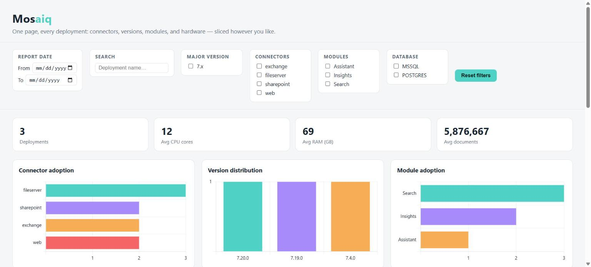

# Mosaiq

**One page, every deployment.** Mosaiq turns a pile of inconsistently-formatted
fleet/deployment inspection reports into a single, explorable, interactive dashboard.



*Generated by [`quickstart/sample-fleet/`](quickstart/sample-fleet/) — see
[`quickstart/`](quickstart/) for the full walkthrough from this sample data to your
own.*

## Why

If you run any kind of software across many independent deployments — on-prem
installs, customer environments, regional clusters — you've probably accumulated
diagnostic/config reports in more than one shape over the years: different tool
versions, different export formats, maybe even a different tool entirely after a
rewrite. Mosaiq reads all of them, normalizes what they have in common, and renders
one static HTML page where you can slice that data by date, search, and filter
instead of digging through individual reports one at a time.

## Scope — how generic is this, really?

Two different things are bundled under "generic" here, and they deserve different
answers.

**The architecture is domain-agnostic.** *Source* (where raw report text comes from)
is decoupled from *Parser* (how to read a given report's format), which is decoupled
from the normalized model, which is decoupled from the dashboard. That separation, and
the two tokenizing engines in `mosaiq/parsers/kv_sections.py` — recognizing "a SECTION
HEADER, then a run of `Key: value` lines" in either a plain-text or markdown shape — is
an extremely common diagnostic-report convention, not specific to any one product.

**The current data model and dashboard are not domain-agnostic.** `DeploymentSnapshot`
(`mosaiq/model.py`) and the charts in `dashboard/templates/` are shaped around one
*category* of product: something that indexes and searches documents. Fields like
`connectors`, `modules`, `index_size_gb`, and `document_count` only mean something for
that kind of deployment. A fleet of web servers or databases would have different
interesting dimensions (request latency, replica count, cache hit rate...) that this
schema has no place for.

So: Mosaiq generically handles **multiple differently-formatted reports describing the
same category of product** — it does not generically handle *any* software product out
of the box. Adapting it to a genuinely different *kind* of product means extending or
replacing `DeploymentSnapshot`'s fields and the dashboard's chart definitions, not just
adding a parser subclass. See "Adding a new report format" below for what *is*
plug-and-play (a new format of the same kind of product).

### Formats supported today

The three formats below are already in active use by some of Mosaiq's users — not a
closed or special list. Adding support for *any other* format, in any shape at all, is
always a data source (which you likely don't need to touch) plus a parser — see
[`quickstart/`](quickstart/) for the full walkthrough, which adds a fourth format via
config alone and a fifth via a custom parser as worked examples.

| Format | Shape | Example fixture |
| --- | --- | --- |
| Banner (`BannerReportParser`) | `#### SECTION ####` headers, `Key: value` lines | `tests/fixtures/banner_report_acme.txt` |
| Markdown (`MarkdownReportParser`) | `## Section` headers, `**Key:** value` lines | `tests/fixtures/markdown_report_contoso.md` |
| Host-profile banner (`HostProfileReportParser`) | Same banner shape, different section names (`HOST IDENTITY`, `SYSTEM RESOURCES`) | `tests/fixtures/host_profile_report_globex.txt` |

## Features

- **Format-agnostic parsing** — a `ReportParser` subclass per report shape, each with
  a cheap fingerprint check (`sniff()`) and a normalizer (`parse()`). Ships with three:
  a plain-text "banner" style, a Confluence-markdown style, and a second tool's own
  banner style with different section names. Unrecognized documents are reported, not
  silently dropped — format drift across tool versions is expected, not an edge case.
- **Source-agnostic fetching** — a Confluence Cloud space or a local folder, decoupled
  from format: either can contain reports in any shape Mosaiq knows how to parse.
- **One single HTML file, nothing else** — the chart library and all filtering logic
  are inlined directly into the page (not referenced as separate files), along with
  the data itself. No backend, no database, no other files to keep together — the
  output is one `.html` file you can email or drop anywhere and it still works exactly
  the same when opened directly, no server required.
- **KPI tiles, adoption charts, hardware distributions, and a documents-vs-hardware
  scatter plot** — switchable between CPU cores, RAM, or disk/index size on the X axis,
  with a trend line and an optional smoothed variant per series (each toggleable
  independently via the chart's own legend, same as the raw data points). A separate
  three-way toggle (PostgreSQL / MSSQL / both combined, any combination at once) overlays
  each database engine's series on the same shared axes — useful since disk sizing in
  particular scales very differently by database engine, and a shared axis makes that
  comparison direct instead of needing separately-scaled charts. Built for real
  questions like "how many deployments run connector X" or "how much CPU/RAM/disk does
  a deployment with N documents typically need, and does that differ by database type."
- **Filter by report date, free text, major version, connector, module, or database
  type** — major version (4.x/5.x/6.x/7.x...) is auto-detected from whatever versions
  are actually present, not a hardcoded list.
- **A sortable, filterable data table** underneath everything, for when a chart isn't
  specific enough.

## Requirements

- Python 3.11+
- `requests` (only needed for the Confluence source — see `requirements.txt`)

## Usage

```bash
pip install -r requirements.txt

# Try it on the bundled sample fleet first - no reports of your own needed yet:
python -m mosaiq build --config quickstart/sample-fleet/config.json \
    --output quickstart/sample-fleet/dashboard.html

# From a local folder of reports:
python -m mosaiq build --source local --path ./reports --output dist/index.html

# From Confluence:
python -m mosaiq build --source confluence \
    --confluence-url https://your-site.atlassian.net/wiki \
    --space SPACEKEY \
    --output dist/index.html
```

| Flag | Required for | Description |
| --- | --- | --- |
| `--source` | always | `local` or `confluence` |
| `--path` | `local` | Folder to scan for `.txt`/`.md`/`.html` reports |
| `--space` | `confluence` | Confluence space key (repeatable for multiple spaces) |
| `--confluence-url` | `confluence` | Base URL, e.g. `https://your-site.atlassian.net/wiki` |
| `--confluence-email` | `confluence` | Account email (or `MOSAIQ_CONFLUENCE_EMAIL` env var) |
| `--confluence-token` | `confluence` | API token (or `MOSAIQ_CONFLUENCE_TOKEN` env var) |
| `--output` | optional | Output HTML path (default `dist/index.html`) |

Confluence credentials resolve in this order: CLI flags → environment variables → a
local `.mosaiq-credentials` file (email on line 1, API token on line 2 — gitignored,
never committed).

The output is a single `index.html` file — open it in any browser, or email/copy it
anywhere. Nothing else needs to travel with it; the chart library, filtering logic, and
data are all inlined into that one file.

## Combining multiple sources

A single `--source` only covers one place. `--config` lets one run pull from several
and combine them into one dashboard — e.g. a local folder plus two different
Confluence page trees:

```bash
python -m mosaiq build --config mosaiq-config.json --output dist/index.html
```

```json
{
  "sources": [
    {"type": "directory", "path": "./reports"},
    {"type": "confluence-tree", "base_url": "https://your-site.atlassian.net/wiki", "page_id": "123456"},
    {"type": "confluence-page", "base_url": "https://your-site.atlassian.net/wiki", "page_id": "789012"}
  ],
  "exclude": ["345678"]
}
```

- `directory` — a local folder, scanned recursively (same as `--source local --path`).
  Only `.txt`/`.md`/`.html` files are read by default; add `"extensions": [".json"]`
  (or whatever your reports use) to an entry to override that.
- `confluence-tree` — one Confluence page plus *every* descendant under it,
  recursively, however deep. Point this at a "mother" page (e.g. a customer-index page
  whose children are per-customer reports) and it pulls in the whole subtree in one
  entry — there's no separate flag for "just the direct children," since pulling in
  everything below is the point of pointing at a mother page at all.
- `confluence-page` — exactly one page, no recursion. For adding a single extra report
  that isn't under any listed tree.
- `exclude` — a list of origin IDs (Confluence page IDs, or relative file paths for
  `directory` sources) to drop from the combined result even though a tree/directory
  entry would otherwise have picked them up — e.g. a non-deployment page (a test
  install, a pre-flight check) that happens to live under a tree of real ones.
- Each `confluence-*` entry can carry its own `"email"`/`"api_token"`, but normally you
  won't need to — they fall back to the same resolution order as `--confluence-email`/
  `--confluence-token` (env vars, then `.mosaiq-credentials`).

Any relative path inside the config (a `directory` source's `path`, a `mapped-field`
parser's `config_file` below) resolves against the *config file's own folder*, not
your current directory — so a config and the files it points at can be run from
anywhere, including straight from the repo root, without `cd`-ing into their folder
first. A `.mosaiq-credentials` file is looked up the same way for any `confluence-*`
source built from a config — next to the config file, not in whatever directory you
happen to run the command from.

If the same deployment name turns up more than once across sources (e.g. it exists in
both a local folder and a Confluence tree), the newest report wins — same
latest-per-deployment rule `build_dashboard` already applies within a single source.

### Adding a format via config, with no code at all

For any report in that same "section header, then key: value lines" shape, you don't
need to write a parser — a `"parsers"` entry maps `DeploymentSnapshot` fields to your
report's own literal field names declaratively:

```json
{
  "sources": [{"type": "directory", "path": "./reports"}],
  "parsers": [
    {"type": "mapped-field", "config_file": "./my-field-mapping.json"}
  ]
}
```

See [`quickstart/config-only-format/`](quickstart/config-only-format/) for the
complete field-mapping schema and a full worked example — including why this is the
recommended way to adapt Mosaiq to a real, proprietary report format you can't make
public: the code involved is 100% generic either way, and the field-mapping file is
the *only* thing that ever needs to stay local.

## Project layout

```
mosaiq/
  model.py                    Normalized DeploymentSnapshot / RawDocument dataclasses
  cli.py, __main__.py         `python -m mosaiq build ...`
  config.py                   Loads a --config JSON file into documents + a parser registry
  sources/
    base.py                   Source contract
    local_directory.py        Reads reports from a local folder
    confluence.py             ConfluenceSource (space), ConfluenceTreeSource (mother
                               page + all descendants), ConfluenceSinglePageSource
  parsers/
    base.py                   ReportParser contract + the two shared tokenizing styles
    kv_sections.py            Shared "section header, then key: value lines" tokenizer
    fields.py                 String -> typed field coercion helpers
    banner_report.py
    markdown_report.py
    host_profile_report.py   One subclass per report format
    mapped_field_report.py   Config-driven parser - no subclass needed, see below
    registry.py               Dispatches each document to the first matching parser
  dashboard/
    generator.py              Aggregates snapshots, renders the final HTML
    templates/                index.html.template + dashboard.js
    assets/                   Vendored Chart.js build
tests/
  fixtures/                   Synthetic sample reports (fictional company names only)
  test_parsers.py, test_confluence_source.py, test_config.py,
  test_fields.py, test_mapped_field_parser.py
quickstart/
  README.md                    Start here - the full walkthrough, start to finish
  sample-fleet/                Run this first - the bundled formats plus two extra
                                sample deployments, also what the screenshot above
                                was generated from
  custom-report-format/        Writing a parser for a totally different report shape
                                (JSON) - when config alone isn't enough
  config-only-format/          Adding a format via config only, no code at all - for
                                any report in the bundled "key: value" shape
```

## Adding a new report format

If your own report format needs to stay local — the common case for a real,
proprietary tool — start at [`quickstart/`](quickstart/) for the full walkthrough:
`quickstart/config-only-format/` (no code) or `quickstart/custom-report-format/` (when
the shape needs real code), keeping the config/parser wherever you keep things that
don't get committed. Nothing below is required for that.

The steps below are for the *other* case: contributing a new format to Mosaiq's own
committed parser list, because it's generic enough to ship and you're happy for it to
be public. This is the plug-and-play case when the new format describes the *same
kind* of deployment (it already maps onto `DeploymentSnapshot`'s existing fields):

1. Add a fixture under `tests/fixtures/` with a couple of made-up deployment names.
2. Write a `ReportParser` subclass in `mosaiq/parsers/` — reuse `BannerStyleParser` or
   `MarkdownStyleParser` if the new format is structurally one of those two shapes,
   otherwise implement `sniff()`/`parse()` directly. `sniff()` needs a fingerprint
   that's reliably true for this format and false for every other one registered.
3. Register it in `mosaiq/parsers/registry.py`.
4. Add a test in `tests/test_parsers.py`.

Adapting Mosaiq to a *different kind* of product entirely (not just a new report shape
for the same kind) is more involved either way: extend `DeploymentSnapshot` with the
fields that matter for that product, then update the dashboard's chart definitions
(`dashboard/templates/dashboard.js`) to use them — no parser, custom or committed,
does that part for you.

## Testing

```bash
pip install -r requirements-dev.txt
python -m pytest
```

All fixtures use entirely fictional deployment names — this repo never contains real
company/customer data. If you run Mosaiq against your own real reports, keep the input
folder and generated `dist/` output out of version control (already covered by
`.gitignore`).

## Author

Built by [Morten Johnsen](https://github.com/mortendj).

## License

MIT — see [LICENSE](LICENSE).
